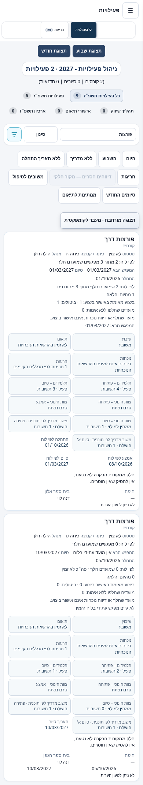
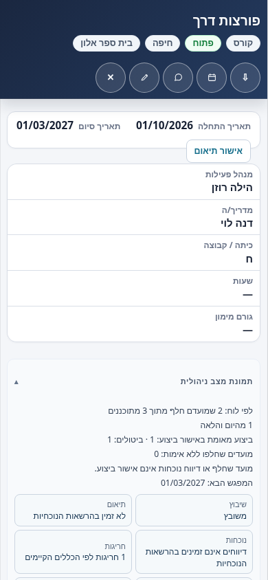
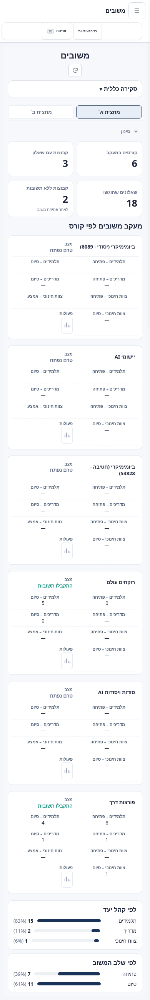
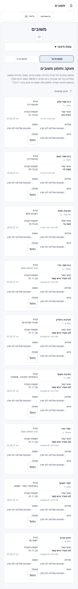
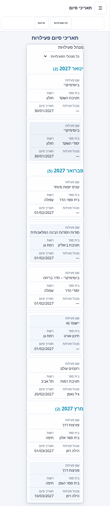
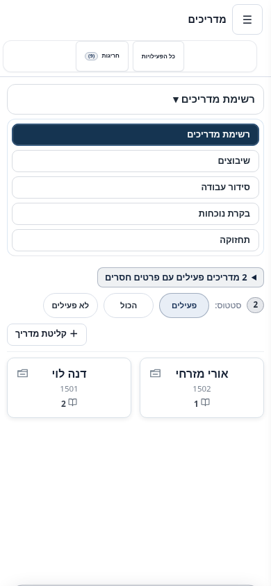
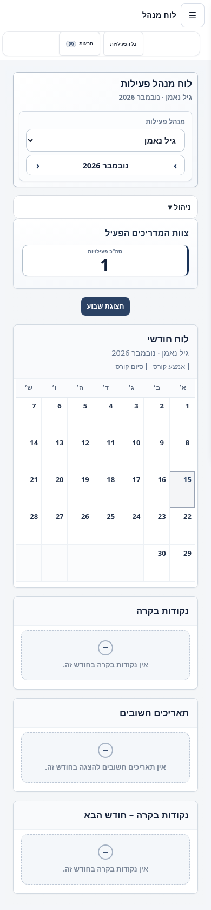

# Mobile management 2027 — PR #2755

Continuation on `codex/mobile-management-2027`, using the original screens, drawer, controls and permissions. The initial presentation stage remains the base. **Full acceptance is still incomplete**: the existing attendance read contract cannot establish missing reports, and some workflows lack a complete local schema. No production writes, migration, Auth/RLS change, send, merge or deployment was performed.

## Management data now connected

`activity-management-data.js` loads read-only evidence for visible activities (or period candidates when a management filter is selected). Queries use batches of at most 60 activity IDs, pagination with truncation rejection, shared in-flight requests, and the existing screen cache. Cache entries are scoped by identity/role/permissions, activity revision and a 60-second TTL. A real authenticated `app_current_role` check prevents stale privileged UI state from converting RLS-hidden rows into verified zero counts. Unauthorized, failed and incomplete sources remain explicitly unknown.

| Indicator | Existing source and meaning | Boundary |
| --- | --- | --- |
| Planned / elapsed / future / next | Persisted session total and numbered activity dates; repeated dates retained, numbered holes preserved | Elapsed is planning, never execution. Known cancellations excluded from next/future |
| Verified execution | Approved `activity_completion_approval_uploads`, activity date and exact comma-separated row membership | Existing activity/date evidence, matching the established scheduling source contract; no inferred execution from time or attendance |
| Cancelled | `course_meeting_cancellations.activity_id` → `activities.row_id`, meeting date | Admin/operation manager only, as existing production RLS allows |
| Instructor assignment/history | Existing assignment-state helper; `course_meeting_instructor_history` exact activity ID | History is recorded events, not an inferred final instructor per meeting; admin/operation manager |
| Coordination | Existing batched coordination context/status | Admin capability; “sent” explicitly does not mean institution approval. Opens original treatment dialog without sending |
| Attendance | Existing secured `get_payroll_attendance_records`, exact text row ID, numeric-ID consistency, meeting number/date | Linked visible report count only; no financial fields. Bundled membership absent from this RPC: **missing report count/filter unavailable** |
| Feedback | Existing secured group and instructor-assignment RPCs, existing campaign status/slot definitions, staff delivery status | Audience/stage and zero/unopened retained. Instructor feedback is instructor+program+academic year, not group. Tokens/contact details discarded |
| Exceptions | Existing permitted exceptions API and canonical exception types | No new rule; unknown source never means zero |
| Checkpoints | Existing manager-board midpoint rule, numbered dates, persisted total/end date | Planned checkpoints; no invented lifecycle tasks |
| Notes/last update | Existing permitted notes state/cache and original editing path | No new private-note read; original actions retained |

Read-only Dashboard metadata/code inspection confirmed the text `row_id` differs from bigint `id`, cancellation setter validates `row_id`, and the checked cancellation rows had no orphan activity IDs. Runtime policies were inspected before enabling a source; schema existence alone was not taken as permission evidence. No Budget Control access or new database object was needed for the connected sources.

The expanded activity card and original drawer now show these statuses and meeting-level evidence. Indicators open existing activity/coordination/feedback treatment or a read-only detail dialog. Exceptions, feedback warning statuses, selected-month endings and pending coordination have filters. Unknown sources are excluded from confirmed matches with an explanation. The missing-report shortcut is disabled and explains its incomplete source.

See [isolated server read-model gaps](read-model-gaps.md). These are unresolved requirements, not completed filters or a request to weaken RLS.

## Other mobile completion

The shared 820px layer retains the existing header/navigation, compact/expanded activities, full-width drawer, uniform monthly cells, selected-day/full-week navigation and compact manager/feedback navigation. Continuation changes add wrapping manager controls/instructor names, local Gantt/tracking overflow, exception cards, safe-area dialog footers and 16px form inputs, instructor-file payroll containment, and labelled end-date cards for **both** the original table and the live replacement table. Original expand/export nodes are retained where the underlying screen exposes them. Closed action dialogs are visually hidden using their existing `aria-hidden` state.

## Relevant verification performed

The original 30 passing Node cases and original 30 fixture/viewport combinations are historical baseline evidence; they were not rerun wholesale. The continuation used selected tests as affected behavior changed:

- 12 new data-contract/cache/filter/checkpoint cases in `tests/activity-management-data.test.mjs`, run incrementally: exact identifiers, batch bounds, independent source errors, privacy, source completeness, real-role mismatch, instructor restrictions, identity/revision cache invalidation, cancelled next meeting, numbered date holes and academic-year feedback isolation. Checkpoint and academic-year cases were run after the final related fix (2 passed).
- Two RPC-wrapper regressions: preserve the original scoped/paginated query builder for unrelated reads and retain instructor-onboarding success/failure behavior. This fixes an existing async wrapper that silently broke management RPC chaining in the actual full application.
- Six affected summary cases after replacing unavailable-only placeholders with evidence; later targeted summary/chip checks after rendering changes.
- Three selected funding/search/assignment/reset cases after list-filter wiring.
- Two selected mobile drawer/end-date cases; the end-date case rerun after adding the actual live-table selector (1 passed).
- Production bundle build passed for the continuation; repeated after the later RPC-wrapper compatibility fix because that changes the bundled entry graph. No legacy/full suite, duplicate `ci:quick`, or new automatic browser workflow.
- Chromium real-worker update: cache 2109 removed, cache 2110 activated, current asset fetched, API response not cached. This uses the actual root shim/worker on a temporary localhost origin.

### Actual local Auth and real screens

There is no staging. Following the existing E2E/impact-feedback fixture approach, disposable localhost Docker services were used: PostgreSQL 16, PostgREST 13.0.7, Supabase GoTrue 2.183.0, localhost-only proxy/Vite. Three **actual GoTrue accounts** have synthetic data: admin, activities_manager, instructor. The application username lookup/password login, JWT identity and server role were exercised; roles were not injected into browser state. No employee account or production personal data was copied.

This is a **partial local schema**, not proof of full production migration/RLS parity. Existing feedback migrations/read guards and extracted current role resolver were installed; local activity/profile/cancellation fixtures enforce role restrictions. Some payroll/history/coordination/automation dependencies were unavailable. Historical migrations could not all be applied sequentially to the minimal fixture (Storage/dependency/type assumptions); no production migration was altered to make the fixture pass.

| Actual process | Result and practical limit |
| --- | --- |
| Full application login, all three roles | Passed; app shell visible, no page errors. Instructor does not receive manager activities shortcut |
| Admin and manager activities | Passed search, expanded cards, ACT-1 original drawer, close/return with search retained; approved execution visible, manager cancellation remains unknown according to access; 390px page width retained |
| New management treatment/filter | Actual admin indicator→feedback→activities return retained the search; desktop advanced exceptions filter loaded additional candidates and returned six canonical matches. Passed after fixing the existing RPC wrapper |
| Existing activity edit form | Open/edit/cancel with reduced 500px viewport; query/expanded state retained, no mutation sent. This is not a save test or a physical keyboard test |
| Feedback permissions | Real local RPC: group read allowed admin/manager, denied instructor (42501). Existing feedback-open RPC allowed admin, denied other two roles. Only synthetic local ACT-3 was changed |
| Cancellation RLS | Real local JWT queries: admin sees synthetic cancellation, manager/instructor see none; UI does not mislabel their hidden source as zero |
| All six feedback tabs | Actual full app/login and real local PostgREST: overview, students, instructors, staff, analysis, templates. Each 390px without page overflow/error; original stage/status controls visible. No sending. One unrelated finance background read was blocked by the harness |
| Dashboard, exceptions, instructors, operations, archive | Actual full app at 390px; no page overflow or page errors. Dashboard district section empty in this fixture; operations landing only; archive empty. These do not establish populated drill-down/workflow correctness |
| Manager board | Actual management/calendar tab rendered at 390px via its existing action; attendance and tracking tabs reached real server calls but blocked by missing local roster RPCs. Navigation/save/Gantt are not accepted |
| End dates | Actual live replacement revealed a second table variant; now included in card enhancement and rechecked |
| Approvals | Blocked: `public.edit_requests` missing in partial local schema. No approval/save/delete performed against production |

Manual scripts: `tests/manual/mobile-management-auth-flows.mjs`, `mobile-management-feedback-tabs.mjs`, `mobile-management-role-contracts.mjs`, `mobile-management-pwa-update.mjs`. Start the application with localhost Supabase environment values; browser scripts use `http://127.0.0.1:5174` and block external traffic. Supply `MOBILE_QA_ACCOUNTS_FILE` with local-only synthetic account objects (`role`, `username`, `password`); never commit that file. `MOBILE_QA_MANAGEMENT_ACTIONS=1` adds the admin treatment/desktop-filter path; `MOBILE_QA_ROLES=admin` can select only that role. `MOBILE_QA_APP_URL` can select another localhost Vite port. `CHROMIUM_PATH` is optional. Browser harnesses strip entry `v` query parameters when forwarding local Vite requests so its query propagation does not create separate state/Auth modules; this matches native unbundled production import resolution. The role-contract harness requires a local public `MOBILE_QA_ANON_KEY`; its optional synthetic ACT-3 mutation is off unless `MOBILE_QA_ALLOW_LOCAL_MUTATION=1`. Output stays in ignored/uncommitted `work/`. The initial renderer-only harness remains available but is not substituted for these authenticated checks.

After the shared dialog visibility fix, admin/manager card screenshots and feedback tabs were recaptured. The final browser passes normalized Vite entry queries; initial navigation attempts that raced the first data render were corrected by waiting for loading to finish. Sanitized local results are in [verification-results.json](verification-results.json).

WebKit installation was attempted; all Playwright download endpoints returned HTTP 403 / Domain forbidden. No WebKit run or physical iPhone/Android test is claimed. See [device and remaining workflow acceptance](device-acceptance.md).

## Original specification coverage

This matrix covers all 25 original sections. “Partial” identifies remaining acceptance, not an assertion that the original task is complete.

| Original section | Implementation/evidence | Remaining |
| --- | --- | --- |
| 1 Goal | Reliable connected activity snapshot substantially implemented | Complete report coverage/role treatment and acceptance below |
| 2 Existing code | Existing screen/drawer/cache/data flow retained | No new project/components duplicating screens |
| 3 Constraints | No production writes, business/Auth/RLS changes or heavy dependency | Preserved |
| 4 Supabase | Exact-ID, permission-aware sources above | Read-model gaps documented separately |
| 5 Mobile design | Existing responsive layer extended; 320–430 baseline, real 390 checks | Physical safe area/keyboard |
| 6 Navigation | Existing hamburger/shortcuts/compact subnavigation retained | Full physical interaction pass |
| 7 Activities | Cards, search, existing/new confirmed filters, evidence/actions | Missing-report filter unavailable; every new treatment action not yet end-to-end verified |
| 8 Progress | Planning distinct from approved execution/cancellation/unknown | Restricted source coverage remains visible |
| 9 Activity drawer | Original form, evidence, meetings/history/checkpoints, contacts/actions, latest update | Actual save/add/approval/send flows not accepted |
| 10 Dashboard/districts | Compact existing KPI/district layout; actual dashboard opened | Populated district drill-down and count correspondence |
| 11 Month | Uniform cells, numeric mobile count, original day interactions | Actual authenticated calendar event flow remains |
| 12 Week | Selected day/full week, retained grouping/filter wrap | Actual authenticated week navigation remains |
| 13 Manager | Compact controls/tabs, local tracking/Gantt overflow; unchanged midpoint math; actual management tab opened | Attendance/tracking roster RPCs missing locally; Gantt, approvals/team documents not accepted |
| 14 Instructors | Existing cards/subnav, wrapping names/stats; actual populated list | Real file, inactive/search, assignment/work-schedule/maintenance flows |
| 15 Feedback | All six actual authenticated tabs passed mobile layout | Full lifecycle edit/send/answer/export and manager-role tab interactions |
| 16 Exceptions/checkpoints | Existing canonical exceptions/filter, planned checkpoints | Activity-linked tasks require exact key; full notification lifecycle unavailable |
| 17 Other screens | Actual end dates, exceptions, operations landing, archive; shared forms | Approvals table unavailable locally; nested operations/add/delete/export workflows |
| 18 Performance | Batches/pagination/coalescing/scope/revision cache; bounded125-row test | No production-scale latency benchmark claimed |
| 19 Security | Actual Auth3 roles, local RPC denials, minimal evidence retention | Partial fixture is not a full production policy audit |
| 20 Priorities | Activity/data P0 first, remaining mobile improvements | P1/P2/P4 acceptance gaps above |
| 21 Acceptance | Verified paths explicitly listed | Overall acceptance incomplete |
| 22 Focused testing | Affected cases only; actual screens used when available | WebKit/physical/missing workflow list |
| 23 Cache/release | Marker v2; cache2110; direct changed entries versioned, root shim unchanged | Release approval and possible version rebase |
| 24 Delivery | Existing PR updated with source findings, real synthetic screenshots and gaps | No merge/deploy |
| 25 Success | Reviewable continuation with authentic management evidence | Full mobile management acceptance cannot yet be claimed |

## Release state

`HOTFIX_VERSION` appends `mobile-management-data-20261114-v2`; `frontend/sw.js` CACHE_VERSION 2109→2110 (initial stage: 2108→2109). Direct mobile JS/CSS, manager runtime and onboarding-wrapper query versions updated. Root `sw.js` unchanged, no additional precache sources/bulky archives. Keep draft until unresolved acceptance/read-model decisions are closed; production release requires approval.

## Updated screenshots — actual application, synthetic localhost data

