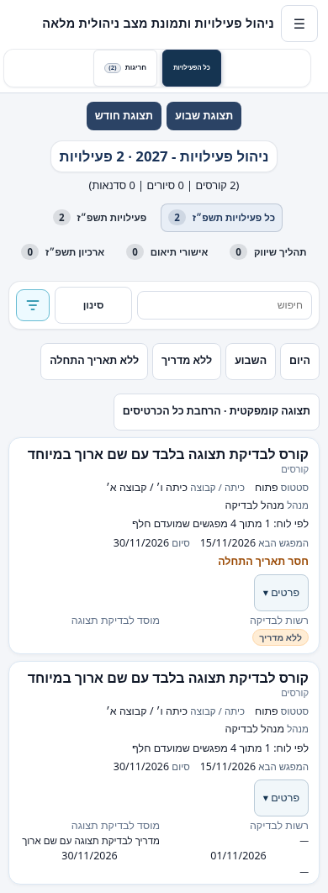
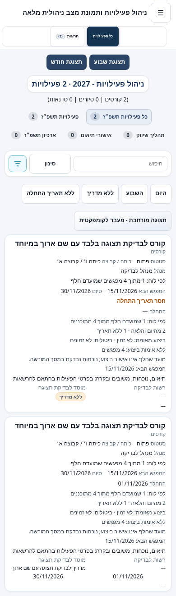
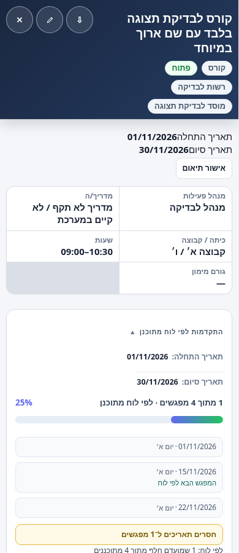
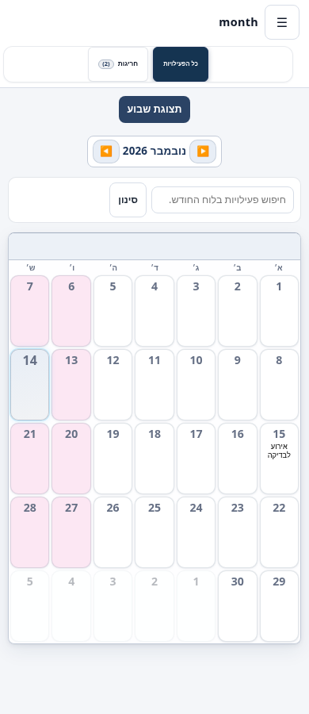
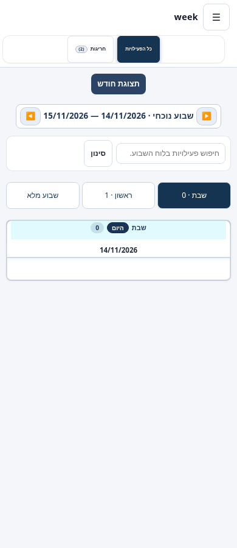
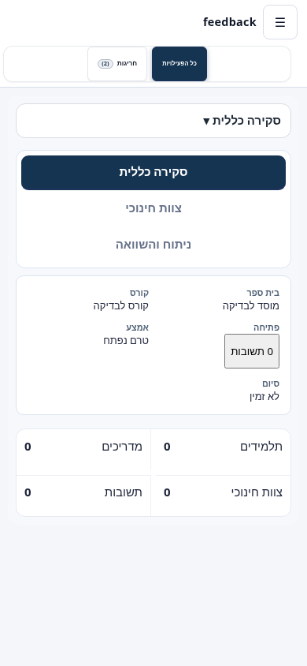
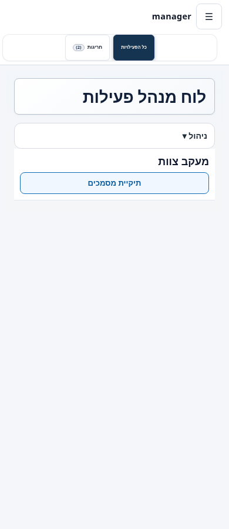
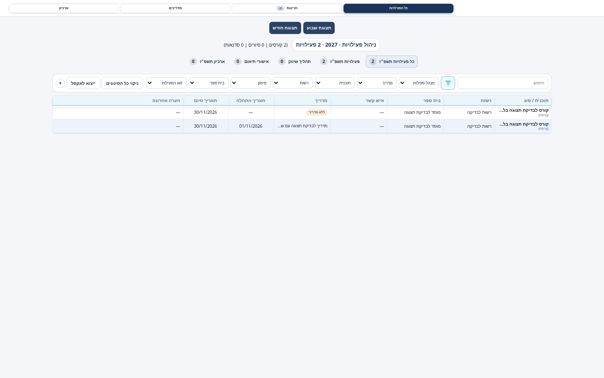

# Mobile management 2027 — implementation and verification

This change extends the existing 820px presentation layer. It does not introduce a separate application or drawer, modify production records, or deploy anything.

## Implementation

- Header: full wrapping screen title, permitted Activities/Exceptions shortcuts; other routes remain in the existing hamburger navigation. Remove the inherited 0.85 screen zoom on phones so touch targets have their actual CSS size.
- Activities: retain original rows, IDs, permissions, search, season, categories, counters and pagination. Add projected status, manager, class/group, planned progress, next meeting, end date and missing start to mobile cards. Compact/expanded presentation shares one summary renderer. Extended cards reuse the existing latest-update cache. No private notes or financial fields are read by the new summary.
- Quick filters: Today/Week set existing meeting date range fields; Missing instructor and Missing start use the existing assignment/presence filters. Existing permitted filters and clear actions remain accessible. Show the advanced filter count and include it in the mobile disclosure count.
- Drawer: retain the layout pipeline and original action elements; use a full viewport, two-column compact fields, wrapping header actions with 44px targets, safe areas, and action bars in the form's layout rather than overlapping the body. Keep the dates section open initially. Isolate late date responses by exact row ID and do not patch an edited form.
- Planning accuracy: keep the legacy progress calculation and label it as planning. Show elapsed, today/future and missing dates separately. A projection without persisted session count cannot invent a planned total. Repeated dates remain separate meetings. Elapsed dates no longer receive a completed/green date chip; highlight the next planned date.
- Week: existing columns and grouping stay intact. Add selected-day/full-week navigation using existing day labels/counts and preserve all columns on desktop.
- Month: retain desktop count wording, use an accessible numeric count on phones and uniform cell sizing. Preserve existing day actions/events.
- Manager/instructors/operations/feedback: extend the existing compact navigation to the permitted manager and feedback tabs; retain original buttons and restore their original attributes when leaving mobile. Keep manager tables/Gantt overflow inside their own containers. Simple feedback group/staff/course/instructor tables use labelled cards; complex comparison matrices retain local scrolling. Existing zero/unopened/unavailable values and stage buttons stay intact.
- Existing mobile dashboard, instructor cards, attendance cards, document tracking and shared form rules are reused.

## Data and permission boundary

Only read-only metadata SQL was executed against Dashboard (`szinlhjuwyiyszdpsdop`). No Budget Control access, writes, migrations, RPC additions, indexes, Auth/OAuth, RLS, payroll, scheduling or sending changes.

Confirmed from schema/code:

- `activities.row_id` is text; `activities.id` is a separate bigint.
- `activity_meetings.source_row_id` is text. The current dates API reads meeting notes by this key, obtains planned dates from the activity, and synthesizes `performed: no`.
- Attendance has both `activity_row_id` and `activity_id`. Cancellation has text `activity_id`. This PR does not assume those identifiers are interchangeable or join by names/dates.
- RLS was enabled on activities, activity_meetings, activity_update_notes, attendance_records and course_meeting_cancellations. This metadata check is **not** a runtime role/row-access test.
- No reliable execution/cancellation source is connected to the list/drawer summary. The UI explicitly says execution and cancellations are unavailable; attendance alone is not treated as execution approval. Existing coordination/send/feedback behavior remains authoritative in its existing controls.
- New code performs zero additional database requests. It reads permitted list fields and existing notes state; details continue through the current lazy API/cache path.

Other sources listed in the brief were not independently loaded, joined or audited. Their mere existence was not used to claim a new integration.

## Validation

30 unique Node test cases passed across:

- `tests/mobile-responsive.test.mjs` — 12 cases: enhancement/cleanup, desktop restoration, day/full-week selection, preserved original controls and feedback values.
- `tests/activity-management-summary.test.mjs` — 6 cases: planning vs execution, duplicate dates, missing totals, Jerusalem date, escaping/privacy, existing quick filters, asynchronous summary, next planned meeting, safe numeric month metadata.
- `tests/activity-detail-sessions-progress.test.mjs` — 7 cases: persisted totals, partial/lazy dates, editing rows and date warnings.
- Two selected `activities-page-filters` cases for rendered funding/search/assignment behavior.
- Three selected PWA cases for the entry shim, old cache removal and bulky-file exclusions.

The initial focused run passed 22 cases. After runtime/summary changes only the affected files/cases were rerun (17 cases, then four summary cases plus one chip-rendering case). No legacy/full suite or automatic browser workflow was added.

Production build passed. It was repeated after the next-meeting rendering change because that change affects the bundle. `git diff --check` passed. No `ci:quick` duplication was needed.

Manual Chromium verification covers 30 combinations: 320/375/390/430/1440px × activities/drawer/month/week/manager/feedback. Assertions check page overflow and full-width drawers/touch targets, plus expand-all, day/full-week and navigation disclosure interactions. Screenshots contain **synthetic local data only**. The activity/drawer/month/week fixtures use the actual renderers and drawer pipeline; manager/feedback fixtures exercise representative component markup, not their full authenticated workspaces.

Run manually (never production):

```sh
npx vite --host 127.0.0.1
# In another terminal; omit CHROMIUM_PATH when Playwright's Chromium is installed:
CHROMIUM_PATH=/usr/bin/chromium node tests/manual/mobile-management-review.mjs
```

The harness blocks external requests. Results/screenshots are written under `work/`. It uses touch/mobile emulation, **not an actual Android phone or iPhone**. Safari/WebKit and real-device tests were not available/run.

## Release preparation

- `HOTFIX_VERSION`: appended `mobile-management-2027-20261114-v1`.
- `frontend/sw.js`: CACHE_VERSION 2108 → 2109.
- Both directly loaded mobile assets have new query-string versions.
- Root `sw.js` remains unchanged; no new cache sources or bulky entries.
- Branch based on main `81546315`; open PRs at start concerned budget access, with no overlapping feature implementation. Shared cache markers may need an increment if another frontend PR merges first.

## Remaining acceptance work / scope limits

This PR is a reviewable implementation package, **not evidence that the full 25-section brief is accepted**.

- Authenticated manager/instructor/admin end-to-end read/edit/save/approval/return-to-list flows still require a permitted test session. No production save/send actions were exercised. Role visibility is preserved by reusing the existing elements/data flow, but has not been independently proved for every role.
- No new unified attendance/feedback/cancellation/notification lifecycle aggregation or per-meeting assignment history was implemented. Missing-report, feedback-treatment and exception-specific activity shortcuts beyond existing category/navigation controls are not added. These need an audited source contract rather than invented predicates.
- Full instructor files, all manager Gantt/attendance states, all six feedback workspaces, operational/edit/delete/export dialogs and dashboard drill-downs were not exhaustively exercised. The presentation rules reuse existing mechanisms; a representative fixture cannot establish every live flow.
- Real iPhone Safari keyboard/safe-area/PWA cache update and Android Chrome checks remain outstanding. Desktop renderer/DOM restoration and representative 1440px screenshots passed; this is not a full desktop regression run.
- No merge or production deployment has been performed. Keep the PR in draft until the remaining acceptance scope is resolved and production release is explicitly approved.

## Synthetic review screenshots









